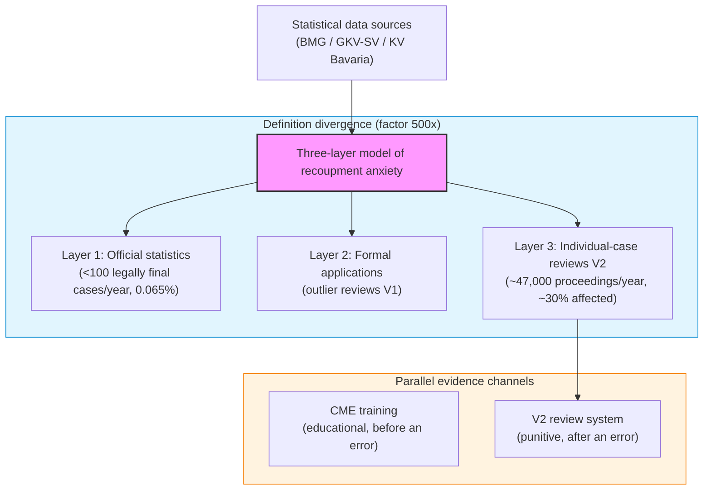

# Regressangst — German Prescribing-Audit Recourse Anxiety (ST-001)

[English documentation](README.md) | [Deutsche Dokumentation](README_de.md)

> [!NOTE]
> **Machine-readable context for AI agents:** A concise repository overview for LLMs, RAG crawlers, and automated indexers is available in [`llms.txt`](llms.txt).

---

  

> **Um:bruch — Think Tank for Social Change**
>
> **Status: Working Paper / multi-perspective stocktake with pilot character** — v0.22, April 2026 | CC BY 4.0
>
> This is an ongoing research project. Its findings are based on publicly available sources and AI-assisted analysis, not on primary data collected by the project. All results are provisional and updated continuously. The work has not yet been submitted to a peer-reviewed journal. It is published as a Working Paper to make the research process transparent and invite feedback.

---

## Start Here

| Goal | Entry point |
|------|-------------|
| Read the study | [`pdf/ST-001_Studie_Regressangst.pdf`](pdf/ST-001_Studie_Regressangst.pdf) |
| German executive summary | [`pdf/ST-001_Executive_Summary.pdf`](pdf/ST-001_Executive_Summary.pdf) |
| English executive summary | [`pdf/ST-001_Executive_Summary_EN.pdf`](pdf/ST-001_Executive_Summary_EN.pdf) |
| Recoupment transparency portal | [`pdf/PP-003_Regress_Transparenzportal.pdf`](pdf/PP-003_Regress_Transparenzportal.pdf) |
| Sources and research core | [`recherche/MASTER-CORE.md`](recherche/MASTER-CORE.md) |
| Check the version | [`meta/VERSIONIERUNG.md`](meta/VERSIONIERUNG.md) |

**Canonical repository:** <https://github.com/um-bruch/regressangst>

**Public project page:** <https://um-bruch.org/projekte/>

Search context: `Regressangst`, `Wirtschaftlichkeitsprüfung`, `ST-001`, `PP-003`, `Regress-Transparenzportal`, `ärztliche Regressangst`, `Um:bruch Regress-Melder`.

## System Architecture and Definition Divergence

## Research Question

The German economic-efficiency review system (§§ 106 ff. SGB V) creates recoupment anxiety among contracted physicians. According to a model calculation, its downstream costs could exceed the recoupments enforced by a factor of 100 to 1,000.

The official recoupment rate is “below 1%”; yet 72% of general practitioners report having experienced a recoupment at least once (Ribbat et al. 2023, n=770, Technical University of Munich). **What happens in the system that produces both at the same time?**

## Central Findings (Provisional)

These findings are based on analysis of publicly accessible data and literature. They are compared against the **MASTER-CORE** (`recherche/MASTER-CORE.md`), which serves as a cross-paper reference framework.

1. **Definition divergence (original synthesis):** “Below 1%” and “72%” are not contradictory; they measure different things. “Recoupment” is defined across three layers: Layer 1 (<100/year, V1 only, legally final, 0.065%) versus Layer 3 (about 47,000 V2 proceedings/year according to BMG GVSG 2024, about 30%). **Factor: about 500x.** The discrepancy is a measurement problem in the statistics, not a perception error by physicians. Original after a prior-art check.

2. **V1 protection-tier model:** V1 outlier review is fairer than public debate suggests (hearing, consultation, grace period, EUR 25,000 cap). The 99.7% rejection rate is not a system failure but a functioning protection model.

3. **V2a/V2b distinction:** Individual-case review (V2) divides into V2a (economic inefficiency, with medical grounds available as a defense) and V2b (formal errors, medically irrelevant, not curable, and without the protection of prior consultation). The certificate error applies at full strength only to V2b.

4. **Dual function (original synthesis):** About 35% of V2 reviews encode medical evidence as formal rules (Category A: biosimilar requirement, AM-RL). About 40% are pure formal checks (Category B). The system has two parallel evidence channels—CME (educational, before an error) and V2 (punitive, after an error)—with no connection between them. Original after a prior-art check.

5. **Empirical confirmation:** Bavaria: 13,332 recoupments set in 2024 among about 24,000 physicians, average EUR 334, about 70% minor cases (SpiFa). A Poisson model (λ=0.85) yields 57% annual affectedness; Ribbat’s 72% is mathematically plausible.

## Limitations and Open Questions

- This is a **secondary analysis**, not original primary research. All data come from public sources.
- The percentages for the dual function (35/40/25%) are **estimates**, not empirically measured.
- The downstream-cost calculation (EUR 0.9–1.7 billion/year) relies on **scenario assumptions** with transparent parameters.
- The causal conclusion “review pressure → undertreatment” is **not empirically established** (Ribbat measures self-report, not care outcomes).
- An independent **replication** of the Ribbat findings is still outstanding.
- **9 IFG requests** have been submitted (deadline about 10 May 2026) and could materially change the evidence base.

## Documents

### Scientific publications (in `paper/` and `pdf/`)

| Document | Version | Pages | Description |
|----------|---------|-------|-------------|
| **ST-001** | v0.22 | 104 | Main study with 7 parts, a counter-position, concluding chapter, and appendices. P0/P1/P2 review and PDF comment rounds implemented. |
| **ST-001 ES (DE)** | v1.3 | 16 | German executive summary with asymmetry subsection, updated recoupment-rate range, and KNV table (15 measures, including care review). |
| **ST-001 ES (EN)** | v1.3 | 16 | English executive summary synchronized with ST-001 v0.22. |
| **PP-003** | v3.1 | 40 | Concept paper for the recoupment transparency portal, including a demand catalogue, hosting-organization scenarios, and an updated cost calculation. |

### Structure of the Main Study (ST-001)

| Part | Content | Method |
|------|---------|--------|
| I | Historical layers (container genealogy 1989–2026) | Legislative history, Bundestag documents |
| II | Doctrinal gap (certificate error, V2a/V2b) | Federal Social Court analysis, statutory interpretation |
| III | Behavioral economics (Ribbat, game theory, Poisson) | Secondary analysis, modeling |
| IV | Downstream costs (EUR 0.9–1.7 billion scenario) | Three-stage model, extrapolation |
| V | Institutional silence (GKV-SV, Public Choice) | Document analysis |
| VI | International comparison (France, Switzerland, UK, Netherlands) | Comparative analysis |
| VII | Solution space (14 measures, KNV ranking) | Cost-benefit analysis |
| Counter-position | 6 objections with responses | Self-critique, Devil’s Advocate |
| Appendix A | Glossary | — |
| Appendix B | Methodology (Walk of Analysis, 15 agents) | Process documentation |
| Appendix C | IFG requests (9 submitted) | Open research questions |

### Research Documentation (in `recherche/`)

- **MASTER-CORE.md** — central findings and methodology; cross-paper reference framework for consistency
- **METHODIK_RECHERCHE_PROTOKOLL.md** — search strategies, sources, and findings by research question
- **WALK_OF_ANALYSIS_EXTENDED.md** — full analysis record (14 phases, 8 knowledge layers)
- **SOURCE_Schutzinstrumente.txt** — legal status of the four protective instruments (§ 29 BMV-Ä, BSG 27/12 R)
- **40 individual analyses** in `recherche/einzelanalysen/` (`RECHERCHE_*`, `MODELL_*`, `NACHANALYSE_*`, `ANALYSE_*`)

### Metadata (in `meta/`)

- **VERSIONIERUNG.md** — document hierarchy and version matrix
- **MASTERPLAN_V2.md** — six-phase completion plan

## Methodology

### Research Design

AI-assisted multi-stream analysis process (April 2026, about 60–80 hours of human and AI work). Four models worked in parallel roles: Claude Opus 4.6 (primary analysis), Copilot GPT-4o (concept refinement), Gemini Deep Research (theoretical framework), and a human (steering and direction decisions).

### Distinctive Methods

- **Cross-source divergence** rather than only cross-model comparison: 15 specialized agents, 25 data points, 14 independent domains
- **Naive-search test:** a simulated journalist finds “below 1%” among the first 5 results
- **Prior-art checks:** two systematic searches (20+ queries each) confirmed the originality of both syntheses
- **Alternative hypothesis tested:** H2 (system as evidence control) has 35–40% explanatory power—acknowledged rather than ignored
- **5 documented hypothesis revisions**, including the dating of individual-case review, a Moosazadeh misattribution, and the cost model

### Methodological Limitations

- Agent prompts are documented as search strategies, but the full instruction texts are not always available
- Gemini outputs required systematic double-checking (documented hallucinations: Moosazadeh, French protest figures)

## License and Citation

CC BY 4.0 — Um:bruch (2026): *Regressangst — Systems-Theory Analysis of Economic-Efficiency Review (§§ 106 ff. SGB V)*. Working Paper ST-001, v0.22. URL: <https://github.com/um-bruch/regressangst>.

Third-party licenses and the dependency inventory: [`THIRD_PARTY_LICENSES.txt`](THIRD_PARTY_LICENSES.txt).
